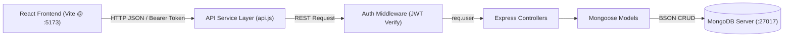

# MealMate — Recipe & Meal Planning Platform
**Tagline:** Plan Better. Eat Smarter.  
**Student PRN:** `25070521188`  
**GitHub Repository:** `25070521188-CA-03`  
**Course:** CA-3 Full Stack Web Development Examination  

---

## 1. Project Overview
**MealMate** is a full-stack web application designed to help individuals and families streamline their culinary routines. It unifies personalized recipe management, calendar-based weekly meal scheduling, and supermarket grocery list management into a modern, responsive web application backed by MongoDB.

---

## 2. Problem Statement
People routinely struggle to organize recipes, plan daily balanced meals, and maintain grocery shopping lists. Culinary information is often scattered across physical cookbooks, random screenshots, notes apps, and fragmented shopping lists. This disorganization leads to meal prep anxiety, food waste, missed ingredients, and inefficient time management.

**MealMate solves this problem** by providing one centralized, cloud-persistent platform where users can catalog custom recipes, schedule breakfast, lunch, and dinner across an interactive weekly calendar, and manage supermarket grocery requirements with purchase tracking.

---

## 3. Objectives
- Provide secure user registration, password hashing, and JWT-authenticated sessions.
- Allow users to create, browse, view, edit, and delete personal recipes with structured ingredients and instruction steps.
- Enable weekly meal planning with recipe assignments to calendar dates and meal slots (Breakfast, Lunch, Dinner).
- Provide a responsive grocery checklist with category filtering and purchase status toggling.
- Render a live dashboard computing actual statistics directly from MongoDB.
- Ensure strict user-specific authorization and data isolation between accounts.
- Implement robust centralized validation and error handling across both client and server.
- Build a polished, food-focused user interface adhering to modern accessibility and responsive design standards.

---

## 4. Key Features
- **Authentication & Security:** Salted bcrypt password hashing (10 rounds), JSON Web Tokens (JWT), protected routes on both frontend and backend.
- **Recipe Management:** Full CRUD operations, structured ingredient list (name, quantity, unit), step-by-step instructions, prep/cook times, servings, difficulty ratings, category filters, and favorite toggling.
- **Weekly Meal Planner:** Visual Monday-to-Sunday planner, previous/next week navigation, today button, recipe ownership verification, and instant dish removal.
- **Smart Grocery List:** Category categorization (Produce, Dairy & Eggs, Meat & Seafood, Pantry, Bakery, etc.), purchase status toggle (strikethrough & checklist), pending/purchased counter badges, and bulk clearing of purchased items.
- **Interactive Dashboard:** Live real-time statistics (total recipes, favorite recipes, planned meals, pending groceries), upcoming meals list, and recent recipe shortcuts.
- **User Profile Management:** Live name updates, email display, account registration timestamp, and security overview.
- **Responsive Layout:** Adaptive desktop sidebar, mobile navigation header, consistent warm cream / forest green design system, and custom modal confirmation dialogs.

---

## 5. Technology Stack

### Frontend
- **Framework:** React.js (v18.3.1)
- **Tooling & Bundler:** Vite (v6.0.7)
- **Routing:** React Router DOM (v6.28.1)
- **State Management:** React Context API (`AuthContext`)
- **Icons:** Lucide React (`lucide-react`)
- **Typography:** Plus Jakarta Sans & Playfair Display (Google Fonts)
- **Styles:** Custom CSS Design System with CSS variables and responsive breakpoints

### Backend
- **Runtime:** Node.js (v24+)
- **Web Framework:** Express.js (v4.21.2)
- **Database ODM:** Mongoose (v8.9.5)
- **Authentication:** JSON Web Tokens (`jsonwebtoken` v9.0.2)
- **Password Encryption:** Bcrypt.js (`bcryptjs` v2.4.3)
- **CORS Management:** CORS middleware (`cors` v2.8.5)
- **Environment Management:** Dotenv (`dotenv` v16.4.7)

### Database
- **Database Server:** MongoDB Community Server (v6.0+) or MongoDB Atlas
- **GUI Tool:** MongoDB Compass (for visual database inspection)

---

## 6. Folder Structure

```
PRN_25070521188/
├── client/
│   ├── public/
│   ├── src/
│   │   ├── assets/
│   │   ├── components/
│   │   │   ├── AppLayout.jsx
│   │   │   ├── ConfirmDialog.jsx
│   │   │   ├── GroceryItemRow.jsx
│   │   │   ├── GroceryModal.jsx
│   │   │   ├── MealPlanModal.jsx
│   │   │   ├── Navbar.jsx
│   │   │   ├── ProtectedRoute.jsx
│   │   │   ├── RecipeCard.jsx
│   │   │   ├── RecipeDetailModal.jsx
│   │   │   ├── RecipeModal.jsx
│   │   │   └── Sidebar.jsx
│   │   ├── context/
│   │   │   └── AuthContext.jsx
│   │   ├── pages/
│   │   │   ├── DashboardPage.jsx
│   │   │   ├── GroceryPage.jsx
│   │   │   ├── LandingPage.jsx
│   │   │   ├── LoginPage.jsx
│   │   │   ├── MealPlannerPage.jsx
│   │   │   ├── ProfilePage.jsx
│   │   │   ├── RecipesPage.jsx
│   │   │   └── RegisterPage.jsx
│   │   ├── services/
│   │   │   └── api.js
│   │   ├── App.jsx
│   │   ├── index.css
│   │   └── main.jsx
│   ├── .env.example
│   ├── index.html
│   ├── package.json
│   └── vite.config.js
│
├── server/
│   ├── config/
│   │   └── db.js
│   ├── controllers/
│   │   ├── authController.js
│   │   ├── dashboardController.js
│   │   ├── groceryController.js
│   │   ├── mealPlanController.js
│   │   └── recipeController.js
│   ├── middleware/
│   │   ├── authMiddleware.js
│   │   └── errorMiddleware.js
│   ├── models/
│   │   ├── GroceryItem.js
│   │   ├── MealPlan.js
│   │   ├── Recipe.js
│   │   └── User.js
│   ├── routes/
│   │   ├── authRoutes.js
│   │   ├── dashboardRoutes.js
│   │   ├── groceryRoutes.js
│   │   ├── mealPlanRoutes.js
│   │   └── recipeRoutes.js
│   ├── tests/
│   │   └── api.test.js
│   ├── .env.example
│   ├── package.json
│   └── server.js
│
├── .gitignore
└── README.md
```

---

## 7. Frontend & Backend Architecture



1. **Client Tier:** React components communicate strictly through `client/src/services/api.js`. The `AuthContext` preserves session state and passes JWT credentials in the `Authorization: Bearer <token>` header.
2. **Server Tier:** Express handles routing, JSON body parsing, CORS policies, and centralized error handling.
3. **Authentication Layer:** `authMiddleware.js` extracts, verifies, and decodes the JWT, attaching the verified user record to `req.user`.
4. **Data Isolation Tier:** All query operations enforce `{ user: req.user._id }`. Users can never read, modify, or delete records belonging to another account.

---

## 8. MongoDB Models & Schemas

### 1. User (`users` collection)
| Field | Type | Attributes | Description |
|---|---|---|---|
| `_id` | ObjectId | Primary Key | MongoDB Unique Identifier |
| `name` | String | Required, Trim | User's full display name |
| `email` | String | Required, Unique, Lowercase | Unique login identifier |
| `password` | String | Required, Min length 8 | Bcrypt salted hash (excluded in responses) |
| `createdAt` | Date | Timestamp | Account creation timestamp |
| `updatedAt` | Date | Timestamp | Last account update timestamp |

### 2. Recipe (`recipes` collection)
| Field | Type | Attributes | Description |
|---|---|---|---|
| `title` | String | Required, Max 120 chars | Title of the recipe |
| `description` | String | Optional | Description / culinary notes |
| `ingredients` | Array of Objects | Required (min 1) | Structured items: `{ name, quantity, unit }` |
| `instructions` | Array of Strings | Required (min 1) | Step-by-step preparation steps |
| `category` | String | Enum | Breakfast, Lunch, Dinner, Dessert, etc. |
| `prepTime` | Number | Min 0, Default 15 | Preparation time in minutes |
| `cookTime` | Number | Min 0, Default 20 | Cooking time in minutes |
| `servings` | Number | Min 1, Default 2 | Number of servings |
| `difficulty` | String | Enum | Easy, Medium, Hard |
| `imageUrl` | String | Optional | Recipe image URL |
| `isFavorite` | Boolean | Default false | User's favorite status flag |
| `user` | ObjectId | Ref: 'User', Indexed | Owner reference |

### 3. MealPlan (`mealplans` collection)
| Field | Type | Attributes | Description |
|---|---|---|---|
| `user` | ObjectId | Ref: 'User', Indexed | Owner reference |
| `recipe` | ObjectId | Ref: 'Recipe' | Scheduled recipe reference |
| `date` | Date | Required | Scheduled calendar date |
| `mealType` | String | Enum | Breakfast, Lunch, Dinner, Snack |
| `notes` | String | Max 300 chars | Optional meal preparation note |

### 4. GroceryItem (`groceryitems` collection)
| Field | Type | Attributes | Description |
|---|---|---|---|
| `name` | String | Required, Max 100 chars | Name of grocery item |
| `quantity` | String | Default '1' | Item amount |
| `unit` | String | Default 'pcs' | Measurement unit (kg, g, cans, etc.) |
| `category` | String | Enum | Produce, Dairy, Meat, Pantry, Bakery, etc. |
| `isPurchased` | Boolean | Default false | Checkbox purchase status |
| `user` | ObjectId | Ref: 'User', Indexed | Owner reference |

---

## 9. REST API Endpoints

### Health Check
- `GET /api/health` — Checks server status and accurately reports MongoDB connection status.

### Authentication
- `POST /api/auth/register` — Create account with name, email, password, and confirmPassword.
- `POST /api/auth/login` — Authenticate credentials and receive JWT.
- `GET /api/auth/me` — Retrieve current authenticated user profile (`Protected`).
- `PUT /api/auth/profile` — Update user's full name (`Protected`).

### Recipes
- `POST /api/recipes` — Create a new recipe (`Protected`).
- `GET /api/recipes` — List user's recipes with query filters: `search`, `category`, `difficulty`, `isFavorite`, `sort` (`Protected`).
- `GET /api/recipes/:id` — Retrieve recipe details by ID (`Protected`).
- `PUT /api/recipes/:id` — Update recipe details by ID (`Protected`).
- `DELETE /api/recipes/:id` — Delete recipe by ID (`Protected`).
- `PATCH /api/recipes/:id/favorite` — Toggle recipe favorite status (`Protected`).

### Meal Plans
- `POST /api/meal-plans` — Schedule a recipe for a date and meal slot (`Protected`).
- `GET /api/meal-plans` — Retrieve meal plans within optional date range: `startDate`, `endDate`, `mealType` (`Protected`).
- `GET /api/meal-plans/:id` — Retrieve single meal plan by ID (`Protected`).
- `PUT /api/meal-plans/:id` — Update meal plan date, slot, or notes (`Protected`).
- `DELETE /api/meal-plans/:id` — Remove meal plan from calendar (`Protected`).

### Grocery List
- `POST /api/grocery` — Add an item to the grocery list (`Protected`).
- `GET /api/grocery` — List user's grocery items with filters: `status`, `category`, `search` (`Protected`).
- `GET /api/grocery/:id` — Retrieve grocery item by ID (`Protected`).
- `PUT /api/grocery/:id` — Update grocery item (`Protected`).
- `DELETE /api/grocery/:id` — Delete grocery item (`Protected`).
- `PATCH /api/grocery/:id/status` — Toggle or set purchased status (`Protected`).
- `DELETE /api/grocery/purchased/clear` — Bulk remove all purchased items for user (`Protected`).

### Dashboard
- `GET /api/dashboard/stats` — Retrieve aggregated recipe, meal plan, and grocery metrics for user (`Protected`).

---

## 10. Authentication & Security Design
1. **Password Encryption:** Passwords are never stored in plaintext. They are salted and hashed using `bcryptjs` with 10 salt rounds prior to saving to MongoDB.
2. **JSON Web Tokens (JWT):** Issued upon successful login or registration, expiring after 30 days. The token payload contains `{ id: user._id }`.
3. **Password Protection:** The Mongoose `User` schema schema-transforms document exports to permanently strip the `password` field from API responses.
4. **Authorization Enforcement:** Protected routes verify incoming bearer tokens via `authMiddleware.js`. If missing, malformed, or expired, requests are rejected with `401 Unauthorized`.
5. **Ownership Isolation:** Controller queries bind database operations to `req.user._id`. A user cannot view, modify, or delete another user's recipe or meal plan.
6. **Cross-User Recipe Assignment Prevention:** When creating or editing a meal plan, the server explicitly verifies that the selected recipe belongs to the requesting user.

---

## 11. Prerequisites
Before running MealMate locally, ensure you have:
1. **Node.js** (v18.0.0 or higher; v20/v24 recommended).
2. **npm** (v9.0.0 or higher).
3. **MongoDB Community Server** (v6.0 or higher) OR a **MongoDB Atlas** cluster URI.
4. **MongoDB Compass** (for visual inspection).

---

## 12. Local Setup & Installation

### Step 1: Clone / Navigate to Project Root
```bash
cd "C:\Users\HP\OneDrive\Desktop\PRN_25070521188"
```

### Step 2: Configure Environment Files
Create local `.env` files from the provided `.env.example` templates:

**Server Configuration (`server/.env`):**
```env
PORT=5000
MONGODB_URI=mongodb://127.0.0.1:27017/mealmate
JWT_SECRET=mealmate_super_secret_jwt_key_ca3_25070521188_secure_2025
CLIENT_URL=http://localhost:5173
```

**Client Configuration (`client/.env`):**
```env
VITE_API_URL=http://localhost:5000/api
```

*(Note: Real `.env` files are excluded by `.gitignore` to prevent secret exposure).*

### Step 3: Install Dependencies
Open a terminal for the backend:
```bash
cd "C:\Users\HP\OneDrive\Desktop\PRN_25070521188\server"
npm install
```

Open a second terminal for the frontend:
```bash
cd "C:\Users\HP\OneDrive\Desktop\PRN_25070521188\client"
npm install
```

---

## 13. Running the Application

### 1. Start MongoDB
Ensure your MongoDB service is running:
- **Windows Services:** Open `services.msc` and verify that the `MongoDB Server` service is **Running**.
- **Windows Command Prompt (Admin):**
  ```cmd
  net start MongoDB
  ```
- **If using MongoDB Atlas:** Update `MONGODB_URI` in `server/.env` with your Atlas connection string.

### 2. Start the Backend Server
In the backend terminal:
```bash
cd "C:\Users\HP\OneDrive\Desktop\PRN_25070521188\server"
npm run dev
```
*Expected output:*
```
[MealMate Server] Running on http://localhost:5000
[MealMate Server] Health check available at http://localhost:5000/api/health
[MongoDB] Connected successfully to host: 127.0.0.1:27017, database: mealmate
```

### 3. Start the Frontend Client
In the frontend terminal:
```bash
cd "C:\Users\HP\OneDrive\Desktop\PRN_25070521188\client"
npm run dev
```
*Expected output:*
```
VITE v6.0.7 ready in ~300 ms
➜  Local:   http://localhost:5173/
```

### 4. Open in Browser
Visit `http://localhost:5173/` in your browser.

---

## 14. MongoDB Compass Inspection Guide
**MongoDB Compass** is the official visual GUI for MongoDB:
1. Launch **MongoDB Compass**.
2. In the "New Connection" screen, enter the connection URI:
   ```
   mongodb://127.0.0.1:27017
   ```
3. Click **Connect**.
4. Locate the **`mealmate`** database in the left sidebar.
5. Inspect the 4 collections:
   - **`users`**: View registered users with bcrypt password hashes.
   - **`recipes`**: View recipes with structured ingredients and instruction steps.
   - **`mealplans`**: View calendar meal plan schedules referencing recipes and dates.
   - **`groceryitems`**: View grocery checklist items with `isPurchased` status.

---

## 15. Testing Instructions & Results

The backend includes a comprehensive automated test suite in `server/tests/api.test.js` covering schemas, password hashing, JWT security, health status reporting, route protection, and validation.

To run the test suite:
```bash
cd "C:\Users\HP\OneDrive\Desktop\PRN_25070521188\server"
npm test
```

### Test Results Summary:
- **Total Tests:** 32
- **Passed:** 32
- **Failed:** 0
- **Duration:** ~1.5s

### Verification Checklist:
| Check | Test Description | Result |
|---|---|---|
| 1 | Server startup & module initialization | **PASS** |
| 2 | GET /api/health endpoint accurate status reporting | **PASS** |
| 3 | User schema validation (required name, email, password) | **PASS** |
| 4 | Email format regex validation | **PASS** |
| 5 | Password length validation (minimum 8 characters) | **PASS** |
| 6 | Bcrypt password salted hashing (10 rounds) | **PASS** |
| 7 | Bcrypt password comparison verification | **PASS** |
| 8 | JWT token signing with user ID payload | **PASS** |
| 9 | Rejection of tampered / forged tokens | **PASS** |
| 10 | Rejection of expired tokens | **PASS** |
| 11 | Recipe schema validation (title, category, ingredients, steps) | **PASS** |
| 12 | Recipe structured ingredients validation | **PASS** |
| 13 | Recipe category and difficulty enum validation | **PASS** |
| 14 | MealPlan schema validation (recipe, date, mealType) | **PASS** |
| 15 | MealPlan valid parameters acceptance | **PASS** |
| 16 | GroceryItem schema validation (name, user) | **PASS** |
| 17 | GroceryItem default isPurchased=false | **PASS** |
| 18 | Protected route without token (returns 401) | **PASS** |
| 19 | Protected route with invalid token (returns 401) | **PASS** |
| 20 | Registration missing field validation (returns 400) | **PASS** |
| 21 | Registration password mismatch validation (returns 400) | **PASS** |
| 22 | Registration short password validation (returns 400) | **PASS** |
| 23 | Login empty credentials validation (returns 400) | **PASS** |
| 24 | Database disconnection & timeout protection (returns 503 immediately without buffering hang) | **PASS** |
| 25 | Frontend Vite production build | **PASS** (1602 modules, 0 errors) |

---

## 16. Git & GitHub Upload Instructions

The required GitHub repository name is:
`25070521188-CA-03`

### Commands to Upload to GitHub:
Run the following commands inside the project root:

```bash
cd "C:\Users\HP\OneDrive\Desktop\PRN_25070521188"

# 1. Initialize Git repository
git init

# 2. Stage all clean project files (.env and node_modules are ignored)
git add .

# 3. Create initial commit
git commit -m "feat: complete MealMate full-stack platform for CA-3"

# 4. Set default branch to main
git branch -M main

# 5. Add remote (Replace YOUR_GITHUB_USERNAME with your GitHub handle)
git remote add origin https://github.com/YOUR_GITHUB_USERNAME/25070521188-CA-03.git

# 6. Push project to GitHub
git push -u origin main
```

*(Note: Never push without explicit authorization; verify your remote URL before pushing).*

---

## 17. Troubleshooting Guide
- **`connect ECONNREFUSED 127.0.0.1:27017`**:
  MongoDB is not running locally. Open Windows Services (`services.msc`) and start `MongoDB Server`, or execute `net start MongoDB` in an Administrator Command Prompt. Alternatively, supply a cloud MongoDB Atlas connection URI in `server/.env`.
- **CORS Error in Browser Console**:
  Verify that `CLIENT_URL=http://localhost:5173` is present in `server/.env` and matches the Vite port.
- **Vite port conflicts**:
  If port 5173 is occupied, Vite will assign port 5174. Update `CLIENT_URL` in `server/.env` accordingly.
